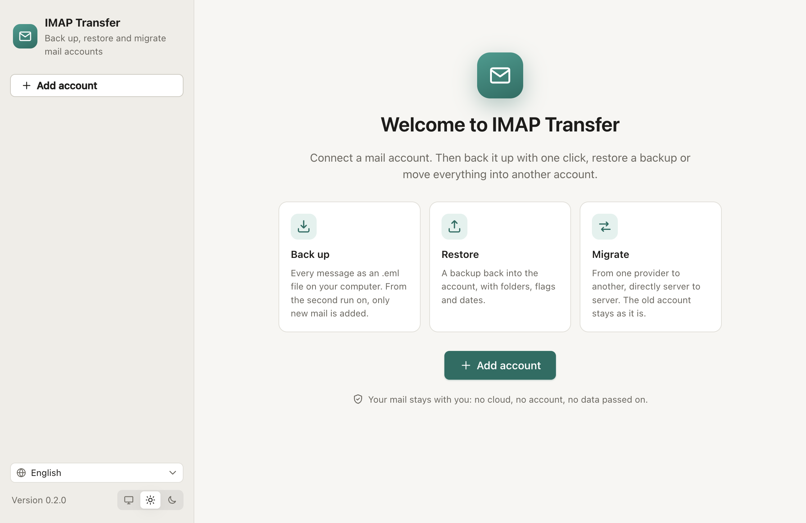
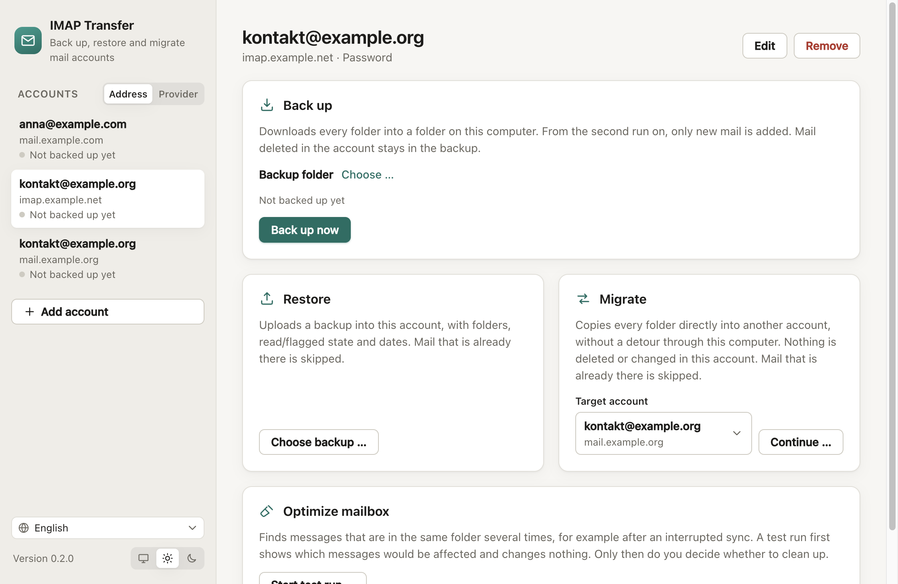
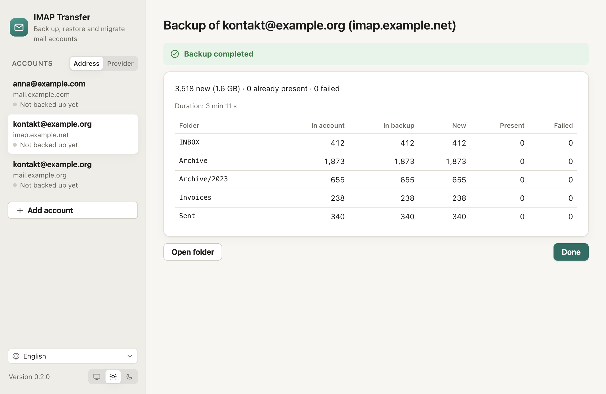
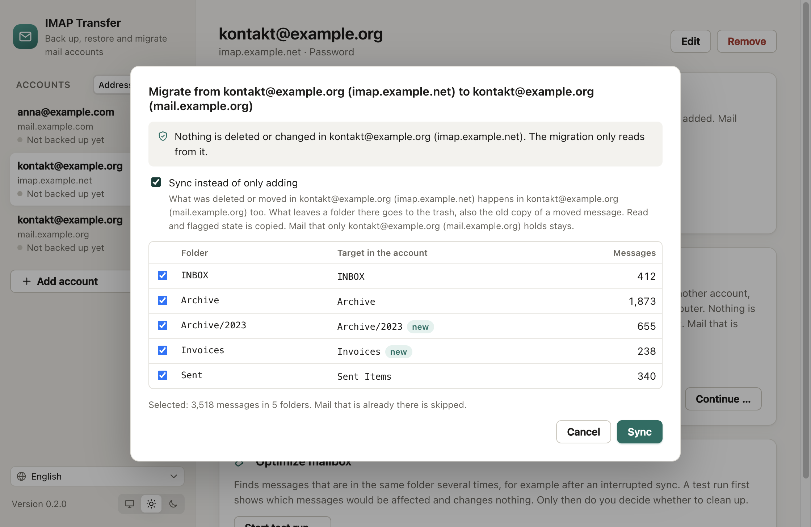
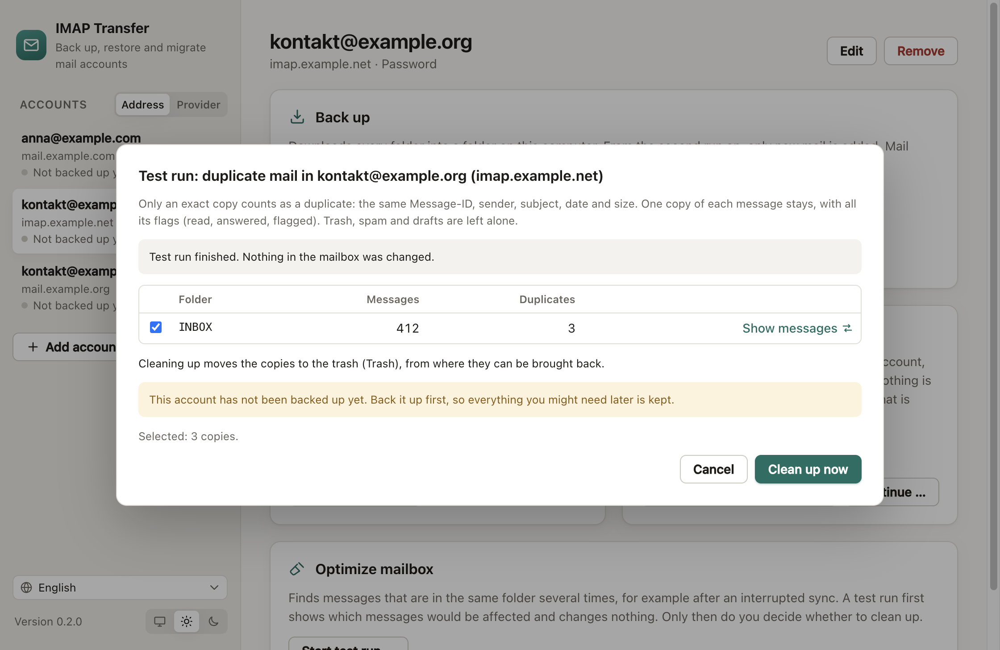

<p align="center">
  
</p>

<h1 align="center">IMAP Transfer</h1>

<p align="center">
  Back up, restore and migrate IMAP mail accounts.<br>
  Free and open source, for macOS, Windows and Linux. Your mail stays on your computer.
</p>

<p align="center">
  <a href="https://imaptransfer.com/download/"><strong>Download</strong></a> ·
  <a href="#command-line">Command line</a> ·
  <a href="docs/architecture.md">How it works</a> ·
  <a href="#auf-deutsch">Deutsch</a>
</p>



## What it does

- **Back up** an account into a folder on your computer. The first run downloads everything; every later run only fetches what is new. Mail you delete in the account stays in the backup.
- **Restore** a backup into the same or another account, with folders, read/flagged state and original dates. Mail that is already there is skipped.
- **Migrate** an account directly into another one, server to server, from any provider to any other. The source account is only read: nothing there is deleted or changed, with or without sync.
- **Keep in sync**, in one direction. A restore or a migration can also sync: what was deleted or moved in the source since the last run is deleted or moved in the target too, and read/flagged state follows the source. What leaves a folder there goes to the trash. Mail that only the target holds, such as new mail after switching over, stays. Run it again whenever you like, or every night with cron.
- **Optimize the mailbox.** An interrupted sync can leave the same message in a folder several times. A test run lists every exact copy without changing anything; only then do you decide to move the copies to the trash.
- **Stop at any time.** A cancelled run, a closed laptop or a dropped connection does no harm: the next run continues where the last one stopped, without duplicates.
- **See how long it takes.** The app estimates the time left, and large messages show their own progress.

The backup is a plain folder: one `.eml` file per message, in the folder structure of the account. Any mail program opens these files with a double click, so your mail stays readable without IMAP Transfer.

<p>
  
  
</p>
<p>
  
  
</p>

## Download

Desktop app: download it from [imaptransfer.com](https://imaptransfer.com/download/), each file with its checksum.

| | |
| --- | --- |
| macOS | `.dmg` (Apple silicon and Intel) |
| Windows | `.exe` installer (x64 and ARM) |
| Linux | `.AppImage` and `.deb` (x64 and ARM) |

The app is in English, German, French, Spanish, Italian, Dutch and Portuguese. It follows the language of your system, or the one you pick at the bottom of the sidebar; light and dark look work the same way.

## Signing in

| Provider | How |
| --- | --- |
| Gmail | An [app password](https://myaccount.google.com/apppasswords) (needs two-step verification). |
| Outlook.com, Hotmail, Microsoft 365 | "Sign in with Microsoft" in the app, or `imaptransfer login microsoft` on the command line. Microsoft no longer accepts passwords for IMAP. |
| iCloud, Yahoo | An app password from the account settings. |
| GMX, WEB.DE, freenet | The normal password; IMAP access must be switched on in the web mail settings first. |
| T-Online | The separate email password, not the login password. |
| Any other provider | Server, port and password; the app suggests settings for many providers. |

Passwords and sign-ins are stored encrypted with the operating system's key store (Keychain on macOS, DPAPI on Windows, libsecret or KWallet on Linux). IMAP Transfer talks only to your mail servers: no telemetry, no account, no cloud.

## Command line

The engine is also a command-line tool, `imaptransfer`, for servers, NAS boxes and cron (Node.js 22.18 or newer):

```sh
npx imaptransfer --help
```

```sh
# Back up (the password comes from IMAPTRANSFER_PASSWORD, a file, or a prompt)
imaptransfer backup ~/Backups/anna --user anna@gmx.de

# What would a restore do? Then do it.
imaptransfer restore ~/Backups/anna --user anna@posteo.de --dry-run
imaptransfer restore ~/Backups/anna --user anna@posteo.de

# Move an account, server to server
imaptransfer migrate --from-user anna@gmx.de --to-user anna@posteo.de

# Keep the new account in step with the old one, one way: run it again any time
imaptransfer migrate --from-user anna@gmx.de --to-user anna@posteo.de --sync

# Check every file of a backup, export it for Thunderbird or Apple Mail
imaptransfer verify ~/Backups/anna
imaptransfer export-mbox ~/Backups/anna ~/Desktop/anna-mbox

# Copies of the same message within a folder: a test run lists them, changing nothing.
# Then move them to the trash.
imaptransfer dedupe --user anna@gmx.de --dry-run
imaptransfer dedupe --user anna@gmx.de
```

Every night at 2:00 with cron (`crontab -e`):

```cron
0 2 * * * imaptransfer backup /srv/backups/anna --user anna@gmx.de --password-file /root/.anna-imap --quiet
```

Container image for a NAS or server:

```sh
docker run --rm -v /volume1/backups/anna:/backup -e IMAPTRANSFER_PASSWORD \
  ghcr.io/scherhans/imaptransfer backup /backup --user anna@gmx.de
```

Exit codes: `0` done, `2` done but some messages failed, `1` failed, `130` stopped, `64` wrong arguments. `--json` prints the report as JSON.

## What a backup looks like

```
anna/
├── README.txt
├── imaptransfer.db                 index: folders, flags, dates, checksums
└── mail/
    ├── INBOX/
    │   └── 2024-05-03_Rechnung Mai_3f2a9c01b4.eml
    └── Archiv/2024/
        └── …
```

Gmail labels are folders in IMAP, so the same message shows up in several folders. IMAP Transfer stores it once and remembers all its folders; a restore puts it back into each of them. A folder that held the same message several times gets them all back.

## Development

```sh
pnpm install
pnpm build                # engine, command line, desktop app, website
pnpm test                 # unit tests and translation checks
pnpm test:integration     # against GreenMail, a local test mail server (needs Java)
pnpm dev                  # desktop app with hot reload
```

The website imaptransfer.com lives in [apps/website](apps/website/README.md).

See [CONTRIBUTING.md](CONTRIBUTING.md), [docs/architecture.md](docs/architecture.md) and [docs/releasing.md](docs/releasing.md).

## Auf Deutsch

IMAP Transfer sichert Mailkonten, spielt Sicherungen zurück und zieht Konten von einem Anbieter zum anderen um. Das alte Konto bleibt dabei, wie es ist: Dort wird nichts gelöscht. Auf Wunsch gleicht es dabei in eine Richtung ab: Was in der Quelle gelöscht oder verschoben wurde, geschieht auch im Ziel, und Mails, die nur im Ziel liegen, bleiben. Die Sicherung ist ein normaler Ordner mit einer `.eml`-Datei pro Mail. Jedes Mailprogramm öffnet sie, auch ohne IMAP Transfer. Die App gibt es auf Deutsch, Englisch, Französisch, Spanisch, Italienisch, Niederländisch und Portugiesisch. Sie richtet sich nach der Sprache des Systems oder nach der, die Sie unten in der Seitenleiste wählen; hell und dunkel ebenso. Ihre Mails bleiben bei Ihnen: keine Cloud, kein Konto, keine Datenweitergabe.

## Support

IMAP Transfer is free and stays free. If it saved you some work, you can support its development on [Buy Me a Coffee](https://buymeacoffee.com/scherhans).

## License

[MIT](LICENSE). IMAP Transfer is provided as is, without warranty; see the license and the [note on liability](https://imaptransfer.com/legal-notice/#liability). Back up your mail before you restore, migrate, sync or clean up.
